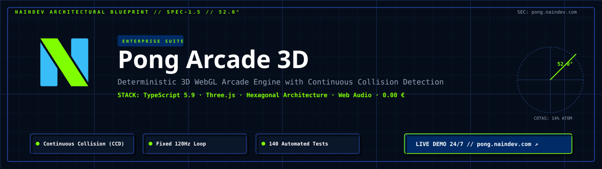
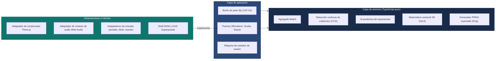

<picture>
  <source media="(prefers-color-scheme: dark)" srcset="docs/assets/banner-dark.svg">
  <source media="(prefers-color-scheme: light)" srcset="docs/assets/banner-light.svg">
  
</picture>

# Pong Arcade 3D — Motor arcade 3D WebGL determinista

[](README.md)
[](#)
[](https://www.typescriptlang.org/)
[](https://threejs.org/)
[](docs/20-architecture.md)
[](docs/50-traceability.md)
[](https://pong.naindev.com)
[](docs/README.md)

Pong rediseñado como un auténtico duelo en una arena tridimensional: las palas se desplazan por el plano $(x, y)$ mientras la bola recorre un túnel de neón a lo largo del eje $z$ entre ambas porterías. Se ejecuta al 100% en navegadores modernos sin descargas de recursos externos, con un bucle de juego con sobrecarga inferior al milisegundo y detección continua de colisiones (CCD).

**Juego en vivo: [pong.naindev.com](https://pong.naindev.com)**

---

## Qué cambió

Originalmente un único archivo `index.html` de 765 líneas que combinaba DOM, física, IA y renderizado en Canvas (conservado en [`legacy/`](legacy/)), el sistema se ha refactorizado en una arquitectura hexagonal limpia con un dominio determinista completamente aislado.

| Característica | Versión 2D heredada | Pong Arcade 3D |
| :--- | :--- | :--- |
| **Arquitectura** | Archivo único de 765 líneas | Arquitectura Hexagonal (`domain`, `application`, `infrastructure`, `ui`) |
| **Simulación** | Espacio 2D de Canvas | Túnel 3D con palas desplazables en dos ejes |
| **Colisiones** | Solapamiento discreto (traspaso a altas velocidades) | Detección analítica continua de colisiones (CCD, sin traspaso) |
| **IA del oponente** | Seguimiento reactivo del eje $y$ | Solucionador predictivo de trayectorias con rebotes intermedios |
| **Bucle de juego** | `dt` dependiente del refresco de pantalla | Paso de tiempo fijo a 120 Hz con interpolación de renderizado ($\alpha$) |
| **Móviles** | Solo escritorio | Control relativo por arrastre, FOV adaptable al formato y botones de 44px |
| **Pruebas** | 0 pruebas | 140 pruebas automatizadas (incluidas pruebas basadas en propiedades con `fast-check`) |

---

## Arquitectura

Las dependencias apuntan estrictamente hacia el interior. El dominio de simulación no conoce nada sobre el navegador, el DOM o Three.js.



### Puntos destacados de diseño

- **Detección continua de colisiones (CCD):** A velocidades de bola de 140 unidades/s y grosor de pala de 0,35, la detección discreta falla. El solucionador de física calcula los momentos exactos de impacto $t_i \in [0, \Delta t]$ contra las paredes del túnel y las palas en movimiento en orden cronológico estricto.
- **Paso fijo con interpolación:** Los pasos de física se ejecutan a 120 Hz deterministas ($8,33\text{ ms}$). Los fotogramas de renderizado interpolan entre pasos mediante el factor $\alpha$, ofreciendo la misma física en pantallas de 60 Hz, 144 Hz o 240 Hz.
- **IA predictiva humanizada:** Los niveles de dificultad (Novato, Pro, Maestro, Singularidad) varían en latencia de reacción, ruido de puntería y horizontes de anticipación en lugar de velocidad artificial de pala.
- **Dirección relativa por arrastre:** En dispositivos móviles, el desplazamiento relativo $(\Delta x, \Delta y)$ guía la pala sin que los dedos del jugador tapen la bola ni la pala.

---

## Controles y entrada

| Acción | Dispositivo de entrada |
| :--- | :--- |
| **Control de pala (J1)** | `W` `A` `S` `D`, Flechas, Arrastre con ratón, Arrastre táctil, Stick analógico izquierdo |
| **Control de pala (J2)** | Teclas de dirección o `I` `J` `K` `L` |
| **Pausar / Reanudar** | `Espacio` / `Esc` / Botón de pausa |
| **Reiniciar partida** | `R` / Botón de reinicio |
| **Cambiar perspectiva de cámara** | `C` / Botón de cámara (Persecución, Cabina, Retransmisión) |
| **Activar / Silenciar audio** | `M` / Botón de audio |

Modos de juego: Un jugador contra la IA, Duelo local para dos jugadores y Demostración CPU contra CPU.

---

## Asignación de puertos locales

Registrado en `dev-ports.json`:

| Servicio | Puerto | Nombre de host / URL |
| :--- | :--- | :--- |
| **Servidor de desarrollo Vite** | `5320` | `http://pong.localhost:5320` |
| **Previsualización Vite** | `5321` | `http://pong.localhost:5321` |
| **Producción** | `443` | `https://pong.naindev.com` |

---

## Desarrollo y verificación

```bash
# Instalar dependencias
npm install

# Iniciar servidor de desarrollo en puerto 5320
npm run dev

# Ejecutar las 140 pruebas automatizadas
npm test

# Puerta de verificación completa: typecheck + pruebas + compilación de producción
npm run check
```

---

## Documentación

Este proyecto sigue **Desarrollo Dirigido por Especificaciones (SDD)**:
- [Charter](docs/00-charter.md) — Visión, principios fundamentales y restricciones
- [Requisitos](docs/10-requirements.md) — Requisitos formales en notación EARS
- [Preguntas abiertas](docs/11-open-questions.md) — Compensaciones y decisiones de arquitectura
- [Arquitectura](docs/20-architecture.md) — Contexto C4, contenedores, componentes y ciclo de paso
- [Decisiones (ADRs)](docs/30-decisions/) — 7 registros de decisiones de arquitectura
- [Tareas](docs/40-tasks.md) — Desglose de trabajo y estados de verificación
- [Trazabilidad](docs/50-traceability.md) — Matriz de requisitos a pruebas (140 pruebas)
- [Runbook](docs/60-runbook.md) — Desarrollo local, puertos y pipeline de entrega

---

## Autor

Arquitectura e implementación por [NainDev (Aitor Nain)](https://github.com/Nain9Dev).
