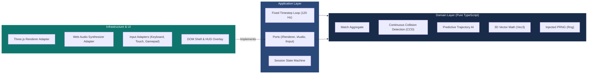

# Pong Arcade 3D — Deterministic 3D WebGL Arcade Engine

[](#)
[](README.es.md)
[](https://www.typescriptlang.org/)
[](https://threejs.org/)
[](docs/20-architecture.md)
[](docs/50-traceability.md)
[](https://pong.naindev.com)
[](docs/README.md)

Pong re-engineered into a true 3D arena duel: paddles glide across the $(x, y)$ plane while the ball travels down a neon tunnel along the $z$-axis between opposite goals. Runs 100% in modern browsers with zero external asset downloads, sub-millisecond game loop overhead, and continuous collision detection (CCD).

**Live Game: [pong.naindev.com](https://pong.naindev.com)**

---

## What Changed

Originally a 765-line single `index.html` file combining DOM, physics, AI, and canvas drawing (preserved under [`legacy/`](legacy/)), the system has been refactored into a clean Hexagonal Architecture with an isolated deterministic domain.

| Feature | Legacy 2D Version | Pong Arcade 3D |
| :--- | :--- | :--- |
| **Architecture** | Single file, 765 lines | Hexagonal Architecture (`domain`, `application`, `infrastructure`, `ui`) |
| **Simulation** | 2D Canvas coordinate space | 3D Arena tunnel with paddles moving on two axes |
| **Collisions** | Discrete overlap (tunneling at high speeds) | Analytical Continuous Collision Detection (CCD, zero tunneling) |
| **Opponent AI** | Reactive $y$-tracking | Predictive trajectory solver with intermediate wall reflections |
| **Game Loop** | Display-dependent `dt` | Fixed 120 Hz timestep with render interpolation ($\alpha$) |
| **Mobile** | Desktop only | Relative drag steering, aspect-aware FOV, 44px touch targets |
| **Tests** | 0 tests | 140 automated tests (including property-based tests via `fast-check`) |

---

## Architecture

Dependencies point strictly inward. The simulation domain knows nothing about the browser, DOM, or Three.js.



### Architectural Highlights

- **Continuous Collision Detection (CCD):** At 140 units/s ball velocity and 0.35 paddle thickness, discrete collision detection tunnels. The physics solver computes exact times of impact $t_i \in [0, \Delta t]$ against tunnel walls and moving paddle volumes in chronological order.
- **Fixed Timestep with Interpolation:** Physics ticks run at a deterministic 120 Hz ($8.33\text{ ms}$). Render frames blend between ticks using interpolation factor $\alpha$, delivering identical gameplay physics on 60 Hz, 144 Hz, and 240 Hz displays.
- **Humanized Predictive AI:** AI difficulty tiers (Rookie, Pro, Master, Singularity) differ in reaction latency, aiming noise, and commitment horizons rather than raw paddle speed.
- **Relative Drag Steering:** On mobile devices, relative displacement $(\Delta x, \Delta y)$ steers the paddle without player fingers occluding the ball or paddle.

---

## Controls & Input

| Action | Input Device |
| :--- | :--- |
| **Steer Paddle (P1)** | `W` `A` `S` `D`, Arrow keys, Mouse drag, Touch drag, Left analog stick |
| **Steer Paddle (P2)** | Arrow keys or `I` `J` `K` `L` |
| **Pause / Resume** | `Space` / `Esc` / Pause button |
| **Restart Match** | `R` / Restart button |
| **Cycle Camera Perspective** | `C` / Camera button (Chase, Cockpit, Broadcast) |
| **Toggle Audio** | `M` / Audio button |

Game modes: Single Player vs AI, Local Two-Player Duel, and CPU vs CPU Demonstration.

---

## Port Allocation

Registered in `D:\Development\Tools\dev-ports.json`:

| Service | Port | Hostname / URL |
| :--- | :--- | :--- |
| **Vite Dev Server** | `5320` | `http://pong.localhost:5320` |
| **Vite Preview** | `5321` | `http://pong.localhost:5321` |
| **Production** | `443` | `https://pong.naindev.com` |

---

## Development & Verification

```bash
# Install dependencies
npm install

# Start development server on port 5320
npm run dev

# Run all 140 automated tests
npm test

# Full verification gate: typecheck + tests + production build
npm run check
```

---

## Documentation

This project follows **Spec Driven Development**:
- [Charter](docs/00-charter.md) — Vision, core tenets, constraints
- [Requirements](docs/10-requirements.md) — Formal EARS requirements
- [Open Questions](docs/11-open-questions.md) — Architecture trade-offs
- [Architecture](docs/20-architecture.md) — C4 context, containers, components, and tick lifecycle
- [Decisions (ADRs)](docs/30-decisions/) — 7 architectural decision records
- [Tasks](docs/40-tasks.md) — Work breakdown and verification states
- [Traceability](docs/50-traceability.md) — Requirements-to-tests matrix (140 tests)
- [Runbook](docs/60-runbook.md) — Local development, ports, and release pipeline

---

## Author

Architecture and implementation by [NainDev (Aitor Nain)](https://github.com/Nain9Dev).
