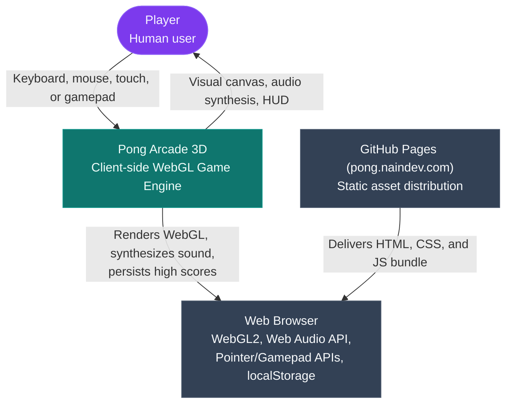
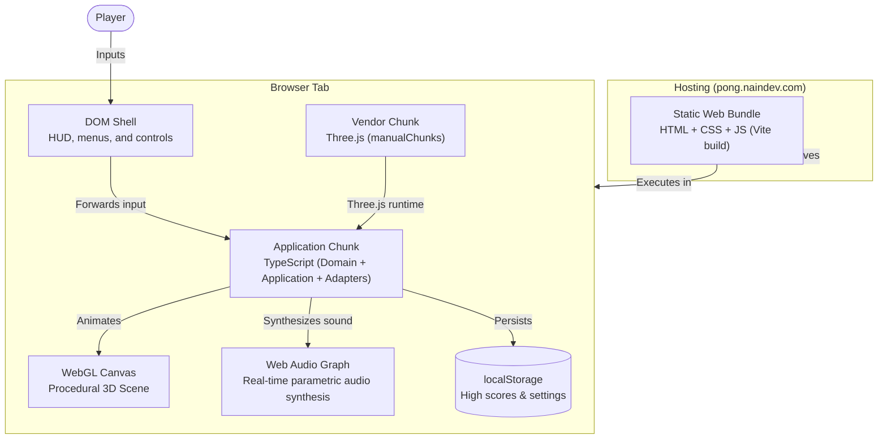
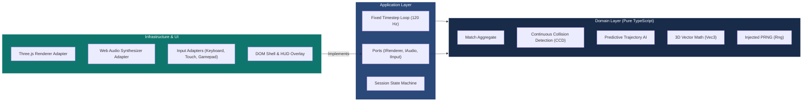

# 20 — Architecture: Pong Arcade 3D

## System Context (C4 Level 1)

Pong Arcade 3D runs entirely on the client within the user's browser. It has no remote backend, telemetry, or user accounts.

---

## Container Diagram (C4 Level 2)

---

## Hexagonal Component Architecture (C4 Level 3)

Dependencies point inward. The domain knows nothing about the browser or Three.js.

---

## The Simulation Tick Lifecycle

Every fixed tick (8.33 ms, 120 Hz):
1. **Poll Inputs:** Collect normalized directional displacement vector $\vec{d} \in [-1, 1]^2$ from active devices.
2. **Advance Paddles:** Move paddles along $(x, y)$ planes, clamped by arena boundaries and dynamic speed limits.
3. **Continuous Collision Detection (CCD):**
   - Trace ball velocity vector $\vec{v}$.
   - Find earliest plane impact time $t_i \in [0, \Delta t]$.
   - Reflect velocity against the boundary normal $\vec{n}$: $\vec{v}' = \vec{v} - 2(\vec{v} \cdot \vec{n})\vec{n}$.
   - Add paddle deflection and tangential spin.
4. **Predictive AI Evaluation:** Compute the ball's terminal $(x, y)$ intersection on the AI goal plane and steer the AI paddle toward target with latency/noise filters.
5. **State Transition:** Check goal planes for score updates, ball reset, or match end.
