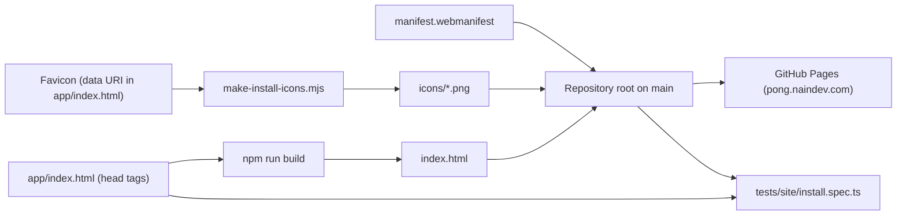

# Installable site — Plan

## Where each piece goes

GitHub Pages publishes the repository root (`main`, `/`, with `.nojekyll`), and the build writes
`index.html` and `assets/` into that same root. Everything the install needs is therefore a static
file of the root or a line in the page head.

- **Manifest**: `manifest.webmanifest` in the root, a static file like `robots.txt`. Covers
  REQ-020 and REQ-021.
- **Icons**: `icons/icon-192.png`, `icon-512.png`, `icon-maskable-512.png` and
  `apple-touch-icon.png`, rendered once from the favicon and committed. Covers REQ-021 and REQ-022.
- **Head tags**: `app/index.html`, the source of the only page. `npm run build` carries its head
  into the deployed `index.html`. Covers REQ-023.
- **Dev server**: a `serve`-only plugin in `vite.config.ts` answers the manifest and icon paths
  from the root. It covers no requirement; it keeps the development console clean.
- **Guard**: `tests/site/install.spec.ts` and the PNG reader `tests/support/png.ts`, inside
  `npm test`. Covers REQ-020 to REQ-023.



## Icons

The mark is the favicon of the page: the data URI of `<link rel="icon">` in `app/index.html`,
URL-decoded into `mark.svg`:

```svg
<svg xmlns='http://www.w3.org/2000/svg' viewBox='0 0 32 32'><rect width='32' height='32' rx='7' fill='#070a16'/><rect x='5' y='9' width='3' height='13' rx='1.5' fill='#22d3ee'/><rect x='24' y='11' width='3' height='13' rx='1.5' fill='#f43f5e'/><circle cx='16' cy='16' r='3.6' fill='#f8fafc'/></svg>
```

The four files were rendered from the repository root with the icon script the ecosystem sites
share. It draws with `sharp` and lives outside this repository, so nothing is added to
`package.json`:

```bash
node make-install-icons.mjs --source mark.svg --out icons --bg "#070a16" --maskable-scale 0.8 --apple-scale 1
```

| File | Canvas | Mark |
| --- | --- | --- |
| `icon-192.png`, `icon-512.png` | Transparent | The favicon at full size, rounded tile included |
| `icon-maskable-512.png` | 512 px, `#070a16` edge to edge | The favicon at 80% (410 px), centred |
| `apple-touch-icon.png` | 180 px, `#070a16` edge to edge | The favicon at full size |

`--bg` is the tile colour of the favicon, so the tile blends into the canvas and only the paddles
and the ball read as the mark. At 80% the farthest pixel of the mark sits 166.8 px from the centre
of the maskable icon, 32.6% of its width, inside the 40% safe radius (204.8 px). At 90% the paddles
came too close to the edge of a round mask, and at the script default (56%) the mark was too small.

## Key decisions

- **Decision**: static files in the repository root.
  - **Discarded alternative**: a Vite `publicDir` under `app/` that the build copies to the root.
  - **Rationale**: the root is already the published site and holds `robots.txt`, `sitemap.xml`
    and `llms.txt` the same way. A public folder would keep every file twice, as source and as
    committed output, and Vite warns on every build when `publicDir` sits inside `outDir`.
- **Decision**: `vite-ignore` on the manifest and `apple-touch-icon` links of `app/index.html`.
  - **Discarded alternative**: plain links, which Vite also leaves untouched today because it
    finds no such files under `app/`.
  - **Rationale**: that fallback is not documented, while `vite-ignore` states the intent. The
    build strips the attribute and leaves a second space before `/>` in `index.html`.
- **Decision**: a development-only plugin serves the manifest and the icons from the root.
  - **Discarded alternative**: leaving the dev server as it was.
  - **Rationale**: rooted at `app/`, it answered the manifest request with its HTML fallback and
    Chrome logged `Manifest: Line: 1, column: 1, Syntax error.` on every load, against the clean
    console spec 001 asks for (REQ-112). The plugin has `apply: 'serve'`: the build output is
    byte-identical with and without it.
- **Decision**: no service worker.
  - **Discarded alternative**: an offline shell for the bundle.
  - **Rationale**: Chrome and iOS install without one, and a cache could serve an old build of
    the game. Owner decision of 2026-11-13.
- **Decision**: the status bar style is `black`.
  - **Discarded alternative**: `black-translucent`, which draws the page under the status bar.
  - **Rationale**: the shared contract sets `black` for dark sites. The HUD already honours the
    safe-area insets, so the translucent style can be judged later on a real iPhone.
- **Decision**: the test decodes the icons with `node:zlib`.
  - **Discarded alternative**: an image library, or reading only the PNG header.
  - **Rationale**: no dependency is added, and the header cannot tell whether an icon is opaque
    or where its mark ends.

## Verification

- `tests/site/install.spec.ts`: manifest members, icon files at their declared size, opacity and
  safe zone, and the head tags of `app/index.html` and `index.html`.
- `Page.getInstallabilityErrors` in headless Chrome against a loopback copy of the files a commit
  publishes (tracked files plus the new ones, nothing ignored).
- After the deploy: the live manifest and the owner's Android phone and iPhone (T-207).
